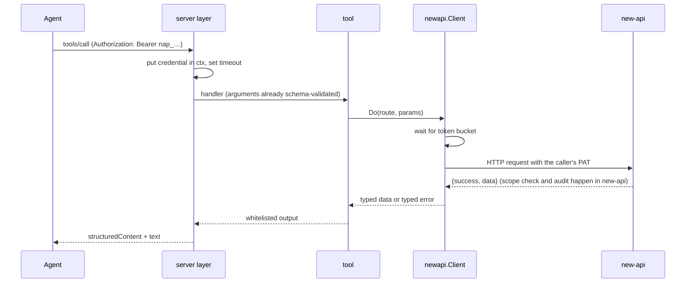

# Architecture

English | [简体中文](architecture.md)

This document describes how new-api-mcp is built: layers, core abstractions, request flow and key trade-offs. For what it does and why, see [design.en.md](design.en.md).

## 1. Constraints

| Constraint | Effect on the architecture |
| --- | --- |
| The process holds no credentials (PAT forwarding) | Credentials arrive and leave with each request; never stored, cached or logged |
| Stateless, no storage | Two-step confirmation cannot rely on server sessions and uses signed tokens instead |
| Depends only on the `/api/*` HTTP contract | No imports of new-api Go packages; contract drift is caught by a checker |
| new-api rate-limits globally by source IP | Outbound calls need a process-wide rate limiter |
| The tool list is maintained by hand | Tools must be declarative and exportable as a manifest for machine checks |
| Logs contain untrusted text | Read tool output may carry prompt injection, so writes cannot rely on the model behaving |

## 2. Layers

```
┌─────────────────────────────────────────────────────────────┐
│ cmd/new-api-mcp          wiring: config → deps → transport   │
├─────────────────────────────────────────────────────────────┤
│ internal/server          MCP adapter                         │
│   HTTP middleware · stdio · credentials · registration · wrap│
├─────────────────────────────────────────────────────────────┤
│ internal/catalog         tool catalogue, filtering by level  │
│ internal/tools/<set>     tools: ops channel logs user        │
│                          pricing option report               │
├──────────────────────────────┬──────────────────────────────┤
│ internal/guard               │ internal/shape               │
│   two-step confirmation      │   paging · truncation ·      │
│   signed tokens              │   time · money               │
├──────────────────────────────┴──────────────────────────────┤
│ internal/newapi          admin API client                    │
│   route constants · envelope · errors · rate limit · retry   │
├─────────────────────────────────────────────────────────────┤
│ internal/config · internal/obs (logging, metrics, token ref) │
└─────────────────────────────────────────────────────────────┘
```

Dependencies only point downward, with three hard rules:

1. **The tool layer touches neither `net/http` nor MCP SDK types.** It knows only the `newapi.Client` interface and its own input and output structs, so tool tests need neither an HTTP server nor an MCP session.
2. **Only `internal/server` imports the MCP SDK.** SDK upgrades and protocol changes stay in that layer.
3. **Only `internal/newapi` knows URL paths.** They live in `routes.go`; tool declarations reference those constants and the contract check reads the same list.

## 3. Core abstractions

### 3.1 Tool declaration

```go
type Spec struct {
    Name        string         // "channel_set_status"
    Toolset     string         // "channel"
    Level       config.Level   // read / operate / write
    Title       string
    Description string         // side effects and known pitfalls
    Routes      []newapi.Route // every endpoint the tool may call (method, path, scope)
    Idempotent  bool
    Timeout     time.Duration  // 0 means the default
}

type Handler[In, Out any] func(ctx context.Context, deps Deps, in In) (Out, error)

func Define[In, Out any](spec Spec, h Handler[In, Out]) Definition
```

`Define` infers JSON Schemas from `In` and `Out` (`jsonschema` tags become field descriptions; fields without `omitempty` are required) and validates arguments before the handler runs. `Spec` is plain data with three consumers: registration filters on level and toolset and derives MCP annotations from it; the `manifest` subcommand exports it as JSON; the contract check reads `Routes`.

### 3.2 new-api client

```go
type Client interface {
    Do(ctx context.Context, req Request, out any) (*Envelope, error)
}

type Request struct {
    Route  Route             // a constant from routes.go
    Params map[string]string // fills :name segments of the path
    Query  url.Values
    Body   any
}
```

The implementation handles:

- **Credentials**: takes this call's PAT from `ctx` and sets `Authorization`; without one it fails without sending anything.
- **Rate limiting**: a process-wide token bucket whose wait honours `ctx`.
- **Envelope**: parses `{success, message, data}`; HTTP 200 with `success=false` is still a failure.
- **Error classification**: typed errors (see section 6).
- **Retries**: one retry after a rate limit; one retry of read requests after a 5xx; writes are never retried automatically.

The base URL comes from configuration and path parameters accept only `[A-Za-z0-9._-]`, so no tool argument can change the target host or escape the route's path. SSRF and path traversal are ruled out by construction.

### 3.3 Credential flow

- HTTP mode: read from the incoming `Authorization: Bearer nap_...`. HTTP middleware rejects requests without a token with 401 before they reach the SDK, so an unauthenticated client cannot even list tools.
- stdio mode: read once from the `NEWAPI_PAT` environment variable at start.

The credential lives only in the `context` of a single call. Logs record a prefix of the PAT's SHA-256 digest, the same algorithm new-api uses for `token_ref` in its audit log, so the two can be correlated directly.

### 3.4 Change guard

Every configuration change implements the same interface and is executed by `guard.Run`:

```go
type Mutation[S any] interface {
    Load(ctx context.Context) (S, error)                     // read the current value
    Plan(current S) (next S, changes []Change, err error)    // pure: compute the new value and the diff
    Apply(ctx context.Context, current, next S) error        // write
}
```

`guard.Run` works as follows:

1. `Load` reads the current value and `Plan` computes the new value and the diff; with no diff it returns "nothing to change".
2. Without a `confirm_token`: it signs a token and returns the diff, **without writing**.
3. With a token: it checks the signature, expiry, tool name, caller, argument digest, and whether the current value digest still matches the preview. Only if all pass does it call `Apply`.

The token is `base64url(payload) + "." + base64url(HMAC-SHA256(payload))`, where `payload` is `{tool, args_sha, state_sha, caller_ref, exp}`:

- `state_sha` acts as an optimistic lock: if the target changed after the preview, the digest no longer matches.
- `caller_ref` binds the token to the PAT that requested the preview, so a leaked token is useless to anyone else.
- `Plan` is a pure function. The most error-prone logic, such as merging options, lives there and is covered by table-driven tests without a network.

## 4. Request flow



Configuration changes take one extra round: the first call returns the diff and a token after `Plan`; the second call runs `Load` again and calls `Apply` only after the checks pass.

## 5. MCP adapter

- Uses the official `github.com/modelcontextprotocol/go-sdk`. HTTP uses `StreamableHTTPHandler` with `Stateless`, `JSONResponse` and `PropagateRequestCancellation` enabled. Stateless mode negotiates both current and earlier protocol versions; the server needs no notifications, sampling or elicitation, and therefore no sessions.
- One `mcp.Server` is built at start with every tool registered and shared by all requests; the tool set is fixed by startup configuration.
- HTTP endpoints: `POST /mcp`, `GET /healthz` (process only), `GET /readyz` (probes new-api's `GET /api/status`), `GET /metrics`.
- Every tool call goes through one wrapper: extract the credential, set the timeout, run, turn errors into hints for the model, check the result size, record logs and metrics, recover from panics.

## 6. Error model

| Kind | Trigger | Retry | Hint for the model |
| --- | --- | --- | --- |
| `unauthenticated` | 401, PAT invalid or expired | no | replace the PAT |
| `scope_denied` | 403 `ACCESS_TOKEN_SCOPE_DENIED` | no | names the missing scope |
| `role_denied` | other 403 | no | account role is insufficient |
| `proof_required` | `SECURITY_PROOF_*` | no | must be done by hand in the console |
| `session_only` | `AUTH_SESSION_REQUIRED` | no | browser sign-in only |
| `incompatible` | `ACCESS_TOKEN_ROUTE_UNDECLARED`, 404 | no | version mismatch |
| `rate_limited` | 429 | once after backoff | try again later |
| `conflict` | 409, or state changed after preview | no | preview again |
| `business` | HTTP 200 with `success=false` | no | new-api's `message` as is |
| `upstream` | 5xx, timeout, connection failure | once for read requests on 5xx | new-api unavailable |

## 7. Concurrency, rate limiting and replicas

- new-api rate-limits by source IP and the MCP process is a single IP to it, so the limiter is process-wide rather than per user. Default 1.5 rps with a burst of 10.
- **Run a single replica.** The server is stateless and restarts lose nothing; more replicas only multiply the outbound rate. If you need several, divide `MCP_UPSTREAM_RPS` among them and give them all the same `MCP_CONFIRM_SECRET`.
- Multiple calls within one tool run sequentially, never fanned out. All outbound requests honour `ctx`, so a client disconnect cancels the request to new-api.

## 8. Output shaping

- **Projection**: each tool defines its own output structs and copies only whitelisted fields into them, so fields new-api adds later do not leak by default.
- **Masking**: channel keys are in no output struct at all; user info in URLs and credentials in channel proxy URLs are masked; header overrides show header names only.
- **Paging and truncation**: a shared `page` / `page_size` input maps to new-api's `p` / `page_size`; long text fields are truncated and marked.

## 9. Observability

- **Logs**: JSON to stderr, one line per tool call with tool name, level, token digest prefix, duration and result kind; free text from arguments is not logged.
- **Metrics**: `mcp_tool_calls_total`, `mcp_tool_duration_seconds`, `newapi_requests_total`, `newapi_ratelimit_wait_seconds`, `mcp_guard_total` (previews, applies, conflicts, expirations).
- **Audit**: new-api's audit log is authoritative; correlate the two through the token digest.

## 10. Testing

| Layer | Approach | Focus |
| --- | --- | --- |
| `newapi` | fake server with `httptest` | envelope parsing, each error kind, cancellable rate-limit waits, no request without credentials, safe path parameters |
| `guard` | pure unit tests | expired, tampered, other caller, other arguments, state changed |
| `tools/*` | fake `newapi.Client` | argument validation, merge logic, no sensitive fields in output |
| `server` | real in-process MCP client | 401 without token, tool filtering by level, token forwarding, error hints |
| contract | `contractcheck` | every route exists with the same scope |
| end-to-end | disposable new-api instance | real calls of every tool, plus the full preview, apply and conflict flow |

## 11. Key trade-offs

| Decision | Rejected alternative | Reason |
| --- | --- | --- |
| Forward the PAT, hold no credentials | A service-account PAT | Permissions and audit attribution reuse new-api; a compromise leaks no long-lived credentials |
| Stateless with signed preview tokens | Store pending changes on the server | No storage; the token carries an optimistic lock and is bound to the caller |
| Declarative `Spec` + hand-written handlers | Generate from OpenAPI; a generic "call any endpoint" tool | The OpenAPI file is incomplete; a generic tool bypasses whitelists and merge logic |
| Tool layer independent of SDK and HTTP | Handlers using SDK types directly | Easy unit tests; isolates SDK and protocol changes |
| Process-wide rate limit + single replica | Per-user limits, multiple replicas | new-api limits by source IP, so per-user limits are meaningless |
| Whitelisted output structs | Fetch everything and delete sensitive fields | Fields added upstream do not leak by default |
| Contract check parses the new-api source | Rely on end-to-end tests only | Catches drift earliest on upgrade, without running services |
