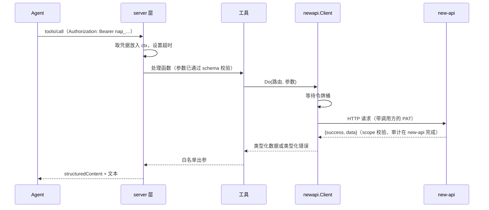

# 架构

[English](architecture.en.md) | 简体中文

本文讲 new-api-mcp 怎么搭：分层、核心抽象、请求流程和关键取舍。“做什么、为什么”见 [design.md](design.md)。

## 1. 约束

| 约束 | 对架构的影响 |
| --- | --- |
| 进程不持有凭据（PAT 透传） | 凭据随请求进、随请求出，不落盘、不缓存、不进日志 |
| 无状态、无存储 | 两步确认不能靠服务端会话，改用签名令牌 |
| 只依赖 `/api/*` HTTP 契约 | 不引用 new-api 的 Go 包；契约漂移靠检查工具发现 |
| new-api 按来源 IP 全局限流 | 出站必须有进程级限速 |
| 工具表手工维护 | 工具必须是声明式的，能导出清单做机器校验 |
| 日志里有不可信文本 | 读工具的输出可能带提示注入，写操作不能只靠模型自觉 |

## 2. 分层

```
┌─────────────────────────────────────────────────────────────┐
│ cmd/new-api-mcp          组装：读配置 → 建依赖 → 起传输层     │
├─────────────────────────────────────────────────────────────┤
│ internal/server          MCP 接入层                          │
│   HTTP 中间件 · stdio · 凭据提取 · 工具注册 · 调用包装         │
├─────────────────────────────────────────────────────────────┤
│ internal/catalog         工具目录与按级别、域过滤              │
│ internal/tools/<域>      工具：ops channel logs user          │
│                          pricing option report                │
├──────────────────────────────┬──────────────────────────────┤
│ internal/guard               │ internal/shape               │
│   两步确认 · 签名令牌          │   分页 · 截断 · 时间 · 金额     │
├──────────────────────────────┴──────────────────────────────┤
│ internal/newapi          管理接口客户端                       │
│   路由常量 · 响应解析 · 错误分类 · 限速 · 超时 · 重试           │
├─────────────────────────────────────────────────────────────┤
│ internal/config · internal/obs（日志、指标、令牌摘要）          │
└─────────────────────────────────────────────────────────────┘
```

依赖只能向下，三条硬规则：

1. **工具层不碰 `net/http` 和 MCP SDK 的类型**，只认 `newapi.Client` 接口和自己的入参、出参结构体。所以工具的单测既不用起 HTTP，也不用建 MCP 会话。
2. **只有 `internal/server` 引用 MCP SDK**。SDK 升级或协议版本变化只影响这一层。
3. **只有 `internal/newapi` 知道 URL 路径**。路径集中定义在 `routes.go`，工具声明引用这些常量，契约检查也读这份清单。

## 3. 核心抽象

### 3.1 工具声明

```go
type Spec struct {
    Name        string         // "channel_set_status"
    Toolset     string         // "channel"
    Level       config.Level   // 只读 / 可逆操作 / 配置变更
    Title       string
    Description string         // 写明副作用和已知坑
    Routes      []newapi.Route // 该工具可能调用的全部接口（方法、路径、scope）
    Idempotent  bool
    Timeout     time.Duration  // 0 表示用默认值
}

type Handler[In, Out any] func(ctx context.Context, deps Deps, in In) (Out, error)

func Define[In, Out any](spec Spec, h Handler[In, Out]) Definition
```

`Define` 根据 `In` 和 `Out` 的类型推断 JSON Schema（`jsonschema` 标签成为字段说明，没有 `omitempty` 的字段为必填），并在调用处理函数之前校验参数。`Spec` 是纯数据，有三个用途：注册时按级别和域过滤并生成 MCP annotations；`manifest` 子命令导出 JSON；契约检查读取 `Routes`。

### 3.2 new-api 客户端

```go
type Client interface {
    Do(ctx context.Context, req Request, out any) (*Envelope, error)
}

type Request struct {
    Route  Route             // 引用 routes.go 里的常量
    Params map[string]string // 填入路径里的 :name
    Query  url.Values
    Body   any
}
```

实现内部负责：

- **凭据**：从 `ctx` 取本次调用的 PAT 写入 `Authorization`；取不到就直接报错，不发请求。
- **限速**：进程级令牌桶，等待过程受 `ctx` 控制。
- **响应解析**：解析 `{success, message, data}`，HTTP 200 但 `success=false` 同样算失败。
- **错误分类**：转成带类型的错误（见第 6 节）。
- **重试**：被限流后重试一次；只读请求遇到 5xx 重试一次；写请求不自动重试。

基地址固定来自配置，路径参数只接受 `[A-Za-z0-9._-]` 字符，因此工具参数无法改变请求的目标主机或跳出路由路径，从结构上排除了 SSRF 和路径穿越。

### 3.3 凭据流转

- HTTP 模式：从入站请求的 `Authorization: Bearer nap_...` 读取。HTTP 中间件会先拦截没有令牌的请求，返回 401，连工具列表都看不到。
- stdio 模式：启动时从环境变量 `NEWAPI_PAT` 读一次。

凭据只存在于单次调用的 `context` 里。日志记录的是 PAT 的 SHA-256 摘要前缀，与 new-api 审计日志的 `token_ref` 同一算法，可以直接关联。

### 3.4 变更守卫

所有配置变更工具都实现同一个接口，交给 `guard.Run` 统一执行两步确认：

```go
type Mutation[S any] interface {
    Load(ctx context.Context) (S, error)                     // 读当前值
    Plan(current S) (next S, changes []Change, err error)    // 纯函数：算出新值和差异
    Apply(ctx context.Context, current, next S) error        // 写入
}
```

`guard.Run` 的逻辑：

1. `Load` 读出当前值，`Plan` 算出新值和差异；没有差异就直接返回“无需修改”。
2. 调用方没带 `confirm_token`：签发令牌并返回差异，**不写入**。
3. 带了令牌：校验签名、过期时间、工具名、调用方、参数摘要，以及当前值摘要是否与预览时一致。全部通过才执行 `Apply`。

令牌格式为 `base64url(payload) + "." + base64url(HMAC-SHA256(payload))`，`payload` 包含 `{tool, args_sha, state_sha, caller_ref, exp}`：

- `state_sha` 起乐观锁作用：预览之后目标被改过，摘要就对不上。
- `caller_ref` 把令牌绑定到发起预览的 PAT，别人拿到令牌也用不了。
- `Plan` 是纯函数，配置合并之类最容易出错的逻辑都落在这里，可以脱离网络做表驱动测试。

## 4. 请求流程



配置变更多一轮：第一次调用在 `Plan` 之后返回 diff 和令牌；第二次调用重新 `Load`，校验通过后才 `Apply`。

## 5. MCP 接入层

- 使用官方 `github.com/modelcontextprotocol/go-sdk`。HTTP 采用 `StreamableHTTPHandler`，开启 `Stateless`、`JSONResponse` 和 `PropagateRequestCancellation`。无状态模式能协商新旧两代协议版本，本服务不需要服务端通知、sampling 或 elicitation，所以也不需要会话。
- 进程启动时建好一个 `mcp.Server` 并注册所有工具，所有请求共用；工具集合由启动配置决定，运行期不变。
- HTTP 端点：`POST /mcp`、`GET /healthz`（只看进程）、`GET /readyz`（探测 new-api 的 `GET /api/status`）、`GET /metrics`。
- 每个工具调用外面套同一层包装：取凭据、设置超时、执行、把错误转成给模型看的提示、检查结果大小、记录日志和指标、捕获 panic。

## 6. 错误模型

| 类型 | 触发条件 | 是否重试 | 给模型的提示 |
| --- | --- | --- | --- |
| `unauthenticated` | 401，PAT 无效或过期 | 否 | 更换 PAT |
| `scope_denied` | 403 `ACCESS_TOKEN_SCOPE_DENIED` | 否 | 指出缺少的 scope |
| `role_denied` | 其他 403 | 否 | 账号角色不足 |
| `proof_required` | `SECURITY_PROOF_*` | 否 | 需要在面板人工完成 |
| `session_only` | `AUTH_SESSION_REQUIRED` | 否 | 只能在浏览器里操作 |
| `incompatible` | `ACCESS_TOKEN_ROUTE_UNDECLARED`、404 | 否 | 版本不匹配 |
| `rate_limited` | 429 | 退避后一次 | 稍后再试 |
| `conflict` | 409，或预览后状态变化 | 否 | 重新预览 |
| `business` | HTTP 200 但 `success=false` | 否 | 原样返回 `message` |
| `upstream` | 5xx、超时、连接失败 | 只读请求的 5xx 重试一次 | new-api 不可用 |

## 7. 并发、限速与副本

- new-api 按来源 IP 限流，而 MCP 进程对它来说就是一个 IP，所以限速器是进程级的，不按用户区分。默认 1.5 rps、突发 10。
- **推荐单副本**。服务无状态，重启无损；多副本会让总出站速率翻倍。确实需要多副本时，把 `MCP_UPSTREAM_RPS` 按副本数均分，并让所有副本使用同一个 `MCP_CONFIRM_SECRET`。
- 单个工具内部的多次调用串行执行，不并发扇出。所有出站请求都受 `ctx` 控制，客户端断开后对 new-api 的请求随之取消。

## 8. 输出整形

- **投影**：每个工具定义自己的出参结构，只把白名单字段拷进去，new-api 新增的字段默认不会漏出来。
- **打码**：渠道 key 永远不在任何出参里；URL 中的用户名密码、渠道代理地址里的凭据会被打码；请求头覆盖只输出头名称。
- **分页与截断**：统一用 `page` / `page_size` 入参，映射到 new-api 的 `p` / `page_size`；单条长文本截断并标注。

## 9. 可观测性

- **日志**：JSON 输出到 stderr，每次工具调用一条，含工具名、级别、令牌摘要前缀、耗时和结果类型，不记录参数里的自由文本。
- **指标**：`mcp_tool_calls_total`、`mcp_tool_duration_seconds`、`newapi_requests_total`、`newapi_ratelimit_wait_seconds`、`mcp_guard_total`（预览、执行、冲突、过期的次数）。
- **审计**：以 new-api 的审计日志为准，两边用令牌摘要关联。

## 10. 测试

| 层 | 方式 | 重点 |
| --- | --- | --- |
| `newapi` | `httptest` 假服务 | 响应解析、每种错误类型、限速等待可取消、无凭据不发请求、路径参数安全 |
| `guard` | 纯单元测试 | 令牌过期、篡改、换调用方、换参数、状态变化后拒绝 |
| `tools/*` | 假的 `newapi.Client` | 参数校验、合并逻辑、出参不含敏感字段 |
| `server` | 进程内的真实 MCP 客户端 | 无令牌 401、按级别过滤工具、令牌透传、错误提示 |
| 契约 | `contractcheck` | 每条路由存在且 scope 一致 |
| 端到端 | 一次性 new-api 实例 | 所有工具的真实调用，以及预览、执行、冲突的完整流程 |

## 11. 关键取舍

| 决策 | 放弃的方案 | 理由 |
| --- | --- | --- |
| PAT 透传，进程不持凭据 | 服务账号 PAT | 权限和审计归属复用 new-api；被攻破不泄露长期凭据 |
| 无状态 + 签名预览令牌 | 服务端保存待确认的变更 | 不引入存储；令牌自带乐观锁并绑定调用方 |
| 声明式 `Spec` + 手写处理函数 | 从 OpenAPI 生成；通用的“调任意接口”工具 | OpenAPI 不全；通用工具会绕过白名单和合并逻辑 |
| 工具层不依赖 SDK 和 HTTP | 处理函数直接用 SDK 类型 | 便于单测；隔离 SDK 和协议的变化 |
| 进程级限速 + 单副本 | 按用户限速、多副本 | new-api 按来源 IP 限流，按用户限速没有意义 |
| 出参使用白名单结构体 | 取全量后删除敏感字段 | 上游新增的字段默认不会外泄 |
| 契约检查解析 new-api 源码 | 只依赖端到端测试 | 升级时最早发现问题，不需要启动服务 |
